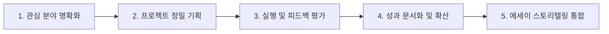

# The Plot : 아이비리그를 향한 설계의 기술 1% Story
> **발행**: 더 노벨컨설팅그룹 (The Nobel Consulting Group)  
> **부제**: 국내 1위 1% 맞춤형 스토리 & 원서 컨설팅 가이드북  

---

## 목차 (Table of Contents)

- [1. 더 노벨컨설팅그룹 소개](#1-더-노벨컨설팅그룹)
  - [1.1 노벨의 철학: 국내 1위 '1% 스토리 컨설팅' 회사를 만든 이유](#11-노벨의-철학-국내-1위-1-스토리-컨설팅-회사를-만든-이유)
  - [1.2 노벨의 성과: 아이비리그 및 미국 TOP 30 합격 실적](#12-노벨의-성과-아이비리그-및-미국-top-30-합격-실적)
  - [1.3 스토리 컨설팅: 아이비리그 합격! 1% 스토리 컨설팅을 모른다면?](#13-스토리-컨설팅-아이비리그-합격-1-스토리-컨설팅을-모른다면)
  - [1.4 원서 컨설팅: 15년 차 전문가들의 1% 원서 컨설팅](#14-원서-컨설팅-15년-차-전문가들의-1-원서-컨설팅)
- [2. The Plot : 아이비리그를 향한 설계의 기술](#2-the-plot--아이비리그를-향한-설계의-기술)
  - [#1 미국 종합 대학 랭킹의 비밀](#1-미국-종합-대학-랭킹의-비밀)
    - [미국 종합 대학 순위 (1~50위)](#미국-종합-대학-순위-150위)
    - [랭킹 산정 요소 및 상세 분석](#랭킹-산정-요소-및-상세-분석)
    - [인기 전공별 대학 랭킹 (CS, Business, Economics, Engineering, Psychology)](#인기-전공별-대학-랭킹)
    - [대학 선택의 전략과 조언: 종합 순위보다 전공 경쟁력](#대학-선택의-전략과-조언-종합-순위보다-전공-경쟁력)
  - [#2 나에게 꼭 맞는 대학 찾기](#2-나에게-꼭-맞는-대학-찾기)
    - [대학 선택, 어디서부터 시작해야 할까?](#대학-선택-어디서부터-시작해야-할까)
    - [신뢰할 수 있는 대학 리서치 플랫폼 활용법](#신뢰할-수-있는-대학-리서치-플랫폼-활용법)
  - [#3 입학사정관이 감동하는 스토리텔링 Passion Project](#3-입학사정관이-감동하는-스토리텔링-passion-project)
    - [Passion Project란 무엇인가?](#passion-project란-무엇인가)
    - [AI 시대 대학이 원하는 인재상](#ai-시대-대학이-원하는-인재상)
    - [성공적인 Passion Project 5단계 수행법](#성공적인-passion-project-5단계-수행법)
    - [명문대 합격생들의 Passion Project 실제 사례 (5대 사례)](#명문대-합격생들의-passion-project-실제-사례)
      - [사례 1: 저널리즘 프로젝트 (A양 - 하버드 등 아이비리그 5개교 동시 합격)](#사례-1-저널리즘-프로젝트-a양)
      - [사례 2: 안경 기부 비영리단체 프로젝트 'Sight Learning' (B군 - USC 합격)](#사례-2-안경-기부-비영리단체-프로젝트-sight-learning-b군)
      - [사례 3: '서울버스' 공공데이터 갈등 극복 앱 개발 (C군 - KAIST 진학)](#사례-3-서울버스-공공데이터-갈등-극복-앱-개발-c군)
      - [사례 4: 암 조기진단 센서 연구 프로젝트 (D군 - ISEF 최고상, 스탠퍼드 합격)](#사례-4-암-조기진단-센서-연구-프로젝트-d군)
      - [사례 5: 초고속 배터리 충전 장치 개발 (E양 - ISEF 2위, 하버드/케임브리지)](#사례-5-초고속-배터리-충전-장치-개발-e양)
    - [결론: 스티븐 코비의 영향력의 원 (Circle of Influence)](#결론-스티븐-코비의-영향력의-원-circle-of-influence)
    - [나만의 Passion Project 탐색 워크시트](#나만의-passion-project-탐색-워크시트)
  - [#4 문과 EC (인문 계열 특별활동 전략)](#4-문과-ec-인문-계열-특별활동-전략)
    - [문과 EC의 방향과 핵심 질문: '무엇을'이 아닌 '어떻게'](#문과-ec의-방향과-핵심-질문-무엇을이-아닌-어떻게)
    - [Top 5 활동별 실전 분석](#top-5-활동별-실전-분석)
      - [01 출판 (Publication) - 스탠퍼드 정치학, NYU 경영 합격 사례](#01-출판-publication)
      - [02 기부금 모금 활동 (Fundraising) - 프린스턴 사회학, 다트머스 교육학 합격 사례](#02-기부금-모금-활동-fundraising)
      - [03 웹사이트 개설 및 관리 (Website Development) - 하버드 사회학, 존스홉킨스 합격 사례](#03-웹사이트-개설-및-관리-website-development)
      - [04 행사 기획 (Event Planning) - 하버드 환경공학 합격 사례](#04-행사-기획-event-planning)
      - [05 해외봉사 (Overseas Volunteering) - 듀크대 건축, NYU 합격 사례](#05-해외봉사-overseas-volunteering)
    - [문과 EC 결론: 요리의 완성도를 결정하는 '어떻게(How)'](#문과-ec-결론)
  - [#5 이과 EC (STEM 계열 특별활동 전략)](#5-이과-ec-stem-계열-특별활동-전략)
    - [STEM 분야 입시의 현실: 뻔한 활동을 특별하게 만드는 15초의 마법](#stem-분야-입시의-현실)
    - [Top 5 활동별 실전 분석](#top-5-활동별-실전-분석-stem)
      - [01 출판 및 논문 연구 (Publication) - 하버드 바이오, 스탠퍼드 생명공학 합격 사례](#01-출판-및-논문-연구-publication)
      - [02 인턴십 (Internship) - 펜스테이트 CS, 예일대 CS 합격 사례](#02-인턴십-internship)
      - [03 클럽 활동 (Club Activity) - 로봇 대회 8강/결승, 수학 클럽 창설 사례](#03-클럽-활동-club-activity)
      - [04 창업 (Entrepreneurship) - 듀크대 뇌과학, 프린스턴 CS 합격 사례](#04-창업-entrepreneurship)
      - [05 대회 (Competition) - MIT 입학 요건과 심층 탐구(Enrichment)](#05-대회-competition)
    - [이과 EC 결론 및 마무리: 학생의 미래를 바꾸는 집요함](#이과-ec-결론-및-마무리)

---

# 1. 더 노벨컨설팅그룹

## 1.1 노벨의 철학: 국내 1위 '1% 스토리 컨설팅' 회사를 만든 이유

### "왜 컨설팅을 이렇게밖에 못할까?"

강남의 수많은 입시 컨설팅 회사들.  
수천만 원의 컨설팅 비용을 청구하면서도, 컨설턴트 한 명이 감당하기 어려운 수의 학생을 맡아 모두 뻔하고 판에 박힌 똑같은 패턴으로 학생을 관리합니다.

수년간 컨설팅 관련 서적과 방대한 입시 데이터를 모조리 분석하고 수많은 합격·불합격 케이스를 연구한 끝에 얻은 결론은 명확했습니다.  
**"학생만의 고유하고 특별한 스토리를 설계하는 것만이 성공의 유일한 열쇠(Key)다."**

그리고 2010년, 노벨컨설팅은 왜곡된 입시 컨설팅 업계를 근본적으로 바꾸겠다는 굳은 결심으로 설립되었습니다.

전쟁터 같은 치열한 입시 환경에서는 지원자의 원서가 첫눈에 입학사정관의 시선을 사로잡아야 합니다.  
여기서 가장 강력한 무기는 입학사정관의 마음을 파고드는 **'학생만의 고유한 스토리'**입니다.

기억에 남는 1%의 스토리를 완성하기 위해서는 학생의 미래를 진심으로 위하는 진정성과 정성, 그리고 끝까지 파고드는 집요함이 필요합니다.  
이것이 지난 15년 동안 노벨이 단 한 번도 타협하지 않은 변함없는 철학입니다.

노벨컨설팅은 이 철학을 실현하기 위해 **학생 한 명의 스토리를 기획하는 데만 전문 컨설턴트 3명이 최소 144시간 이상을 투입**합니다.  
노벨은 타협하지 않습니다. 학생을 위해 최선을 넘어선 '혼신의 힘'으로 반드시 증명해냅니다.

---

## 1.2 노벨의 성과: 아이비리그 및 미국 TOP 30 합격 실적

| 아이비리그 합격 | 미국 TOP 20 합격 | 상위 30위권 합격 |
|:---:|:---:|:---:|
| **77명** | **363명** | **421명** |

### 주요 합격자 명단 발췌

| 번호 | 학생 | 합격 대학교 | 번호 | 학생 | 합격 대학교 |
|:---:|:---:|:---|:---:|:---:|:---|
| 1 | 조 \* \* | Harvard University | 20 | 이 \* \* | Columbia University |
| 2 | 유 \* \* | Harvard University | 21 | 이 \* \* | Columbia University |
| 3 | 허 \* \* | Yale University | 22 | 안 \* \* | Columbia University |
| 4 | 김 \* \* | Princeton University | 23 | 안 \* \* | Columbia University |
| 5 | 곽 \* \* | Princeton University | 24 | 김 \* \* | Columbia University |
| 6 | 공 \* \* | Princeton University | 25 | 김 \* \* | Columbia University |
| 7 | 홍 \* \* | Stanford University | 26 | 김 \* \* | Columbia University |
| 8 | 한 \* \* | Stanford University | 27 | 최 \* \* | University of Pennsylvania |
| 9 | 전 \* \* | Stanford University | 28 | 정 \* \* | University of Pennsylvania |
| 10 | 오 \* \* | Stanford University | 29 | 이 \* \* | University of Pennsylvania |
| 11 | 박 \* \* | Stanford University | 30 | 이 \* \* | University of Pennsylvania |
| 12 | 김 \* \* | Stanford University | 31 | 유 \* \* | University of Pennsylvania |
| 13 | 전 \* \* | California Institute of Technology (Caltech) | 32 | 신 \* \* | University of Pennsylvania |
| 14 | 김 \* \* | California Institute of Technology (Caltech) | 33 | 박 \* \* | University of Pennsylvania |
| 15 | 공 \* \* | MIT (Massachusetts Institute of Technology) | 34 | 김 \* \* | University of Pennsylvania |
| 16 | 지 \* \* | Brown University | 35 | 김 \* \* | University of Pennsylvania |
| 17 | 전 \* \* | Brown University | 36 | 홍 \* \* | Cornell University |
| 18 | 이 \* \* | Brown University | 37 | 한 \* \* | Cornell University |
| 19 | 심 \* \* | Brown University | 38 | 조 \* \* | Cornell University |

*(그 외 다수 명문대 합격생 배출)*

---

## 1.3 스토리 컨설팅: 아이비리그 합격! 1% 스토리 컨설팅을 모른다면?

쌓여 있는 수만 장의 원서 속에서 입학사정관이 지원자 한 명을 검토하는 시간은 **단 몇 분**에 불과합니다.  
그 찰나의 순간에 아이비리그 합격 여부가 결정됩니다.

- GPA 학점 관리
- SAT & TOEFL 공인 성적
- AP, IB 디플로마 코스워크
- 교내/외 활동, 리서치 프로젝트, 수상 경력...

미국 입시가 쉽다고 말씀드리지 않겠습니다.  
**하지만 결코 무질서하거나 복잡하기만 한 것은 아닙니다.**

노벨컨설팅은 학생 한 명의 스토리를 세밀하게 기획하기 위해:
1. **전문 컨설턴트 3명이 144시간 이상 투입**
2. **1:3 초밀착 심층 컨설팅 진행**
3. 학생의 내면과 관심사를 120% 파악하여 세상에 하나뿐인 독창적 스토리 구성

입학사정관에게 송곳처럼 강렬한 인상을 남겨 **"반드시 면접관과 캠퍼스에서 만나보고 싶은 학생"**으로 각인시킵니다.  
노벨컨설팅은 기회를 단 하나도 놓치지 않습니다.

> *"저희는 어렵더라도, 학생은 가장 확실하고 바른 길로 갈 수 있도록 이끌겠습니다."*

---

## 1.4 원서 컨설팅: 15년 차 전문가들의 1% 원서 컨설팅

미국 대학 입시에서는 종종 **에세이 한 편으로 믿기 힘든 '기적 같은 역전'**을 일궈내는 학생들이 있습니다.

A4 용지 단 몇 장에 자신의 지난 학업 여정과 인생관, 미래 비전을 압축해 치열한 입시 경쟁을 뚫어내야 하기에 많은 학부모님과 학생들이 막막함을 토로합니다.

### "원생 92% 최초 목표 대학 이상 합격! 어떻게 가능했을까요?"

- **15년 차 전문 연구진**
- **3,000명 이상의 학생 1:1 심층 상담**
- **1,000건 이상의 명문대 원서 컨설팅 완수**

기존 업계의 낡은 관행과 천편일률적인 템플릿으로는 기적 같은 역전을 기대하기 어렵습니다.  
노벨컨설팅은 최신 입시 트렌드 감각, 철저한 데이터와 통계, 그리고 탄탄한 스토리를 기반으로 한 **'근거 있는 전략 컨설팅'**을 고수하며 매년 자체 합격률 기록을 경신해 왔습니다.

> **"빠른, 편한, 많은"** — 노벨과는 어울리지 않는 단어입니다.  
> 시간이 오래 걸리더라도 학생만의 독보적인 차별점이 녹아 있는 스토리, **합격할 수밖에 없는 독보적 에세이**를 완성해 냅니다.

---

# 2. The Plot : 아이비리그를 향한 설계의 기술

## #1 미국 종합 대학 랭킹의 비밀

대다수 학생과 학부모님들은 "대학 종합 순위가 높을수록 무조건 더 우수한 학교이며, 입학하기도 훨씬 어려울 것"이라고 믿습니다.  
**하지만 실제 입시 데이터는 결코 그렇지 않습니다.**

### 미국 종합 대학 순위 (1~50위)

| 순위 | 대학교명 (영문) | 비고 |
|:---:|:---|:---|
| **1** | Princeton University | |
| **2** | Massachusetts Institute of Technology (MIT) | |
| **3** | Harvard University | |
| **공동 4** | Stanford University | |
| **공동 4** | Yale University | |
| **6** | University of Chicago | |
| **7** | Duke University | |
| **8** | Johns Hopkins University | |
| **9** | University of Pennsylvania (UPenn) | |
| **10** | Northwestern University | |
| **11** | California Institute of Technology (Caltech) | |
| **12** | Dartmouth College | |
| **13** | Brown University | |
| **14** | Vanderbilt University | |
| **15** | UC Berkeley | 주립 |
| **16** | Rice University | |
| **17** | UCLA (University of California, Los Angeles) | 주립 |
| **18** | Washington University in St. Louis (WashU) | |
| **19** | Cornell University | |
| **20** | University of Notre Dame | |
| **21** | Columbia University | |
| **22** | Carnegie Mellon University (CMU) | |
| **23** | University of Michigan - Ann Arbor | 주립 |
| **24** | Emory University | |
| **25** | Georgetown University | |
| **26** | University of Virginia (UVA) | 주립 |
| **27** | University of North Carolina at Chapel Hill (UNC) | 주립 |
| **28** | University of Southern California (USC) | |
| **29** | University of Florida | 주립 |
| **30** | University of Texas at Austin (UT Austin) | 주립 |
| **31** | New York University (NYU) | |
| **32** | Georgia Institute of Technology (Georgia Tech) | 주립 |
| **33** | UC San Diego (UCSD) | 주립 |
| **34** | UC Davis | 주립 |
| **35** | Boston College | |
| **36** | University of Wisconsin - Madison | 주립 |
| **37** | University of Illinois Urbana-Champaign (UIUC) | 주립 |
| **38** | Tufts University | |
| **39** | Wake Forest University | |
| **40** | Case Western Reserve University | |
| **41** | Boston University | |
| **42** | Brandeis University | |
| **43** | University of Maryland - College Park | 주립 |
| **44** | Georgia State University | 주립 |
| **45** | Purdue University - West Lafayette | 주립 |
| **46** | Ohio State University - Columbus | 주립 |
| **47** | Rutgers University - New Brunswick | 주립 |
| **48** | University of Georgia | 주립 |
| **49** | Villanova University | |
| **50** | Pepperdine University | |

---

### 랭킹 산정 요소 및 상세 분석

미국 대학 평가(US News 등) 지표는 단순 지원자 합격률만으로 산정되지 않습니다. 주요 평가 가중치는 다음과 같습니다:

1. **타 학교 동료 평가 (Peer Assessment)**: 타 대학의 총장, 학장, 입학처장 등이 1~5점 척도로 매긴 학문적 평판 점수
2. **졸업률 및 유지율 (Graduation & Retention Rate)**: 입학한 학생이 6년 이내 학위를 취득하고 졸업하는 비율
3. **학생 1인당 교육 지출액 (Instructional Spending)**: 수업, 연구 설비, 학생 편의 복지 서비스에 대학이 투자하는 순수 학자금 규모
4. **졸업 후 급여 및 사회적 이동성 (Post-Graduate Outcomes)**: 졸업 4년 후 연방 학자금 수혜 학생이 고졸 대비 높은 소득을 올리는 비율
5. **표준화 시험 성적 (Standardized Test Scores)**: 신입생의 SAT/ACT 중위 50% 점수대

이 외에도 교수 1인당 학생 비율, 논문 인용 횟수, 기부금 펀드 규모 등 무수히 많은 통계적 요소가 복합적으로 작용합니다.  
따라서 **"종합 순위가 높다고 해서 모든 전공이 압도적으로 우수하거나 입학이 일률적으로 어려운 것은 아니며, 순위가 다소 낮더라도 특정 전공 분야에서는 세계 최고 수준의 경쟁력을 자랑하는 대학이 많다"**는 사실을 반드시 기억해야 합니다.

특히 **주립 대학교(State Flagship)**의 경우 정원의 상당수(50~80% 이상)를 해당 주(In-State) 거주 학생에게 의무 배정하므로, 주외 학생(Out-of-State)이나 유학생(International)에게는 아이비리그 못지않은 극심한 경쟁률이 형성되기도 합니다.

---

### 인기 전공별 대학 랭킹

#### 1. Computer Science (컴퓨터 과학)
| 순위 | 학교명 | 순위 | 학교명 |
|:---:|:---|:---:|:---|
| **1** | MIT | **공동 5** | University of Illinois Urbana-Champaign (UIUC) |
| **2** | Stanford University | **공동 5** | Georgia Institute of Technology |
| **3** | Carnegie Mellon University (CMU) | **공동 5** | University of Washington |
| **4** | UC Berkeley | **공동 5** | Cornell University |
| **공동 5** | Princeton University | **공동 5** | UT Austin |
| **공동 5** | University of Michigan - Ann Arbor | **공동 5** | Caltech |

#### 2. Business (경영학)
| 순위 | 학교명 | 순위 | 학교명 |
|:---:|:---|:---:|:---|
| **1** | University of Pennsylvania (Wharton) | **6** | Carnegie Mellon University (Tepper) |
| **2** | MIT (Sloan) | **7** | University of Texas at Austin (McCombs) |
| **3** | UC Berkeley (Haas) | **8** | Cornell University (Dyson) |
| **4** | University of Michigan - Ann Arbor (Ross) | **9** | UNC Chapel Hill (Kenan-Flagler) |
| **5** | New York University (Stern) | **10** | Indiana University - Bloomington (Kelley) |

#### 3. Economics (경제학)
| 순위 | 학교명 | 순위 | 학교명 |
|:---:|:---|:---:|:---|
| **1** | Harvard University | **6** | Yale University |
| **2** | MIT | **7** | UC Berkeley |
| **3** | Stanford University | **8** | Northwestern University |
| **4** | University of Chicago | **9** | Columbia University |
| **5** | Princeton University | **10** | University of Pennsylvania |

#### 4. Engineering (공학)
| 순위 | 학교명 | 순위 | 학교명 |
|:---:|:---|:---:|:---|
| **1** | MIT | **6** | Carnegie Mellon University |
| **2** | Stanford University | **7** | Purdue University - West Lafayette |
| **3** | UC Berkeley | **8** | University of Michigan - Ann Arbor |
| **4** | California Institute of Technology (Caltech) | **9** | UIUC |
| **5** | Georgia Institute of Technology | **공동 10** | UT Austin |

#### 5. Psychology (심리학)
| 순위 | 학교명 | 순위 | 학교명 |
|:---:|:---|:---:|:---|
| **1** | Stanford University | **공동 5** | Yale University |
| **공동 2** | UC Berkeley | **공동 5** | UIUC |
| **공동 2** | Harvard University | **공동 8** | MIT |
| **공동 2** | UCLA | **공동 8** | University of Minnesota |
| **공동 5** | University of Michigan - Ann Arbor | **공동 8** | University of Pennsylvania |

---

### 대학 선택의 전략과 조언: 종합 순위보다 전공 경쟁력

위의 종합 랭킹과 전공별 랭킹을 비교해 보면 매우 중요한 불일치를 발견할 수 있습니다.

- **NYU**: 종합 순위 31위이지만, **Stern 경영대학**은 전미 5위로 아이비리그 대다수보다 높습니다.
- **Carnegie Mellon(CMU)**: 종합 순위 22위이지만, **컴퓨터 과학(CS)**은 MIT, 스탠퍼드와 함께 부동의 전미 1~3위를 다툽니다.
- **Indiana University Bloomington**: 종합 순위는 73위로 50위권 밖이지만, 학부 경영대학인 **Kelley School of Business는 전미 10위**에 랭크되어 코넬이나 UNC와 어깨를 나란히 합니다.

인디애나 대학교 켈리 경영대학이 이토록 높은 평가를 받는 이유는 세계적인 명성의 교수진, 월스트리트와 포춘 500대 기업으로 이어지는 강력한 기업 네트워크, 그리고 체계적인 인턴십 지원 시스템 덕분입니다. 이는 자연스럽게 졸업 후 압도적인 취업률과 높은 연봉으로 직결됩니다.

따라서 대학 지원 전략을 수립할 때는 **단순히 간판 종합 순위에 얽매이지 말고, 학생이 공부하고자 하는 구체적인 전공 분야의 역량, 교수진 수준, 인턴십 파이프라인, 그리고 커리어 비전과의 일치 여부**를 면밀히 분석해야 합니다.

---

## #2 나에게 꼭 맞는 대학 찾기

### 대학 선택, 어디서부터 시작해야 할까?

미국에는 4,000개가 넘는 4년제 대학이 존재합니다.  
"목표 대학을 일찍 설정하라"는 조언은 누구나 하지만, 방대한 정보의 홍수 속에서 실제로 우리 아이에게 딱 들어맞는 대학을 선별하는 것은 결코 쉽지 않습니다.

- *"공신력 있는 학교 정보는 어디에서 조사해야 하는가?"*
- *"어떤 잣대로 대학 리스트(Reach / Target / Safety)를 구성해야 하는가?"*
- *"우리 아이의 학업적·개인적 성향에 최적화된 캠퍼스는 어디인가?"*

수많은 선택지 속에서 성공적인 입시 로드맵을 구축하기 위해서는 공인된 데이터를 활용한 체계적인 리서치 프레임워크가 필수적입니다.

### 신뢰할 수 있는 대학 리서치 플랫폼 활용법

성공적인 명문대 지원자들이 필수로 활용하는 공신력 있는 5대 플랫폼:

1. **BigFuture (by College Board)**:  
   SAT 주관사인 칼리지보드가 직접 운영하는 플랫폼으로, 표준화 시험 점수대, GPA 분포, 합격률 통계 및 맞춤형 전공 탐색 기능 제공.
2. **College Scorecard (미국 교육부 공식 데이터)**:  
   연방 정부 데이터베이스를 기반으로 실제 등록금 비용, 학자금 대출 부채율, 졸업 후 전공별 평균 소득(Salary After Attending)을 객관적으로 비교.
3. **Common Data Set (CDS)**:  
   각 대학 입학처가 매년 공식 공시하는 원시 데이터 보고서. 입학 사정 시 GPA, 추천서, 에세이, 특별활동(EC), 인터뷰 등의 실질 반영 비중(Very Important / Important / Considered)을 가장 정확하게 확인 가능.
4. **Niche**:  
   재학생들의 솔직한 캠퍼스 라이프 평점, 기숙사, 학내 치안, 교수진 만족도 등 정성적 분위기를 파악하기에 최적화된 플랫폼.
5. **U.S. News & World Report**:  
   가장 보편적인 종합 및 단과대학/전공별 세부 순위 지표를 제공하여 지원 전략의 벤치마크 수립에 유용.

---

## #3 입학사정관이 감동하는 스토리텔링 Passion Project

### Passion Project란 무엇인가?

> **Passion Project(패션 프로젝트)**란 학생이 진정으로 깊은 호기심과 열정을 느끼는 분야를 스스로 정의하고, 주도적으로 시간과 노력을 집중하여 사회적·학문적으로 의미 있는 구체적인 결과물을 완성해내는 장기 프로젝트입니다.

### AI 시대 대학이 원하는 인재상

생성형 AI가 인간의 지식 검색과 단순 코딩, 정형화된 과제를 순식간에 대신하는 시대입니다.  
이에 따라 아이비리그를 비롯한 명문 대학들은 단순 암기력이나 정량적 시험 만점자보다 다음의 역량을 입증하는 학생을 절실히 찾고 있습니다:

- **다면적 비판적 사고력**: 문제를 다양한 각도에서 입체적으로 바라보고 창의적인 솔루션을 제시하는 인재
- **독창적 전문성과 끈기**: 특정 학문 또는 사회 이슈에 몰입하여 끝까지 파고드는 집념
- **협업과 공감 능력**: 다양한 배경의 동료들과 유기적으로 소통하며 시너지를 내는 팀워크
- **선한 영향력의 리더십**: 올바른 가치를 제시하고 동료와 커뮤니티에 영감을 불어넣는 리더

**바로 이 지점에서 Passion Project가 입시의 당락을 가르는 결정적인 역할을 합니다.**  
단순 나열식 스펙 쌓기를 넘어, 학생의 독자적인 관심사를 증명하고 입학사정관의 뇌리에 각인되는 강력한 스토리텔링의 원천이 되기 때문입니다.

---

### 성공적인 Passion Project 5단계 수행법



1. **관심 분야 명확화 (Identify Passion)**:  
   자신이 시간을 잊고 몰입하는 지점을 발굴하고, 일상이나 커뮤니티에서 개선하고 싶은 구체적인 문제 정의.
2. **프로젝트 정밀 기획 (Action Plan)**:  
   명확한 목표, 단계별 마일스톤, 필요한 리소스(멘토, 도구, 예산)를 설정하고 실현 가능한 타임라인 수립.
3. **실행 및 피드백 평가 (Execute & Iterate)**:  
   가설을 검증하며 실제 실행에 옮기고, 전문가 및 사용자의 피드백을 수용하여 결과물의 완성도를 극대화.
4. **성과 문서화 및 확산 (Share & Impact)**:  
   연구 보고서 발간, 논문 발표, 웹/앱 배포, SNS 홍보, 미디어 보도 등을 통해 실질적인 사회적 영향력 확장.
5. **에세이 스토리텔링 통합 (Integrate Narrative)**:  
   진행 과정에서 마주한 실패와 갈등, 극복 과정에서 깨달은 인격적·학문적 성장을 대학 원서 에세이와 면접의 핵심 테마로 승화.

---

### 명문대 합격생들의 Passion Project 실제 사례

#### 사례 1: 저널리즘 프로젝트 (A양)
- **합격 대학**: 하버드, 프린스턴, 컬럼비아, 브라운, 유펜 (아이비리그 5개교 동시 합격)
- **프로젝트 내용**:  
  9학년 때 저널리즘 수업을 계기로 교내 신문사 기자로 활동 시작. 10학년 때 로스앤젤레스 통합교육구 교사노조(UTLA) 파업 현장을 발로 뛰며 직접 취재. 피켓 시위를 하는 은사들과의 인터뷰를 통해 '학생을 향한 교사들의 진심'을 전달하는 기사를 작성하여 지역 사회에 큰 반향을 일으킴.  
  프린스턴 저널리즘 캠프에 선발되어 기사 작성 전문성을 키웠으며, 코로나19 팬데믹 기간에도 화상 인터뷰(Zoom)를 적극 활용하여 학교 신문 편집장으로서 사회적 소외 이슈를 심층 조명.
- **노벨의 분석**:  
  단순히 신문부 활동에 머무르지 않고, 자신이 속한 커뮤니티의 첨예한 사회적 갈등 속으로 직접 뛰어들어 현장 취재를 이끌어낸 실천력이 돋보였습니다. 특히 팬데믹이라는 제약 속에서도 줌 인터뷰라는 창의적 대안을 찾아내 지속성을 증명한 점이 입학사정관들에게 문제 해결력과 사회적 기여도로 높이 평가받았습니다.

#### 사례 2: 안경 기부 비영리단체 프로젝트 'Sight Learning' (B군)
- **합격 대학**: 남가주대학교 (USC)
- **프로젝트 내용**:  
  9학년 태권도 수련 중 안경이 깨지는 사고를 겪음. 새 안경을 맞추는 일주일 동안 칠판 글씨가 보이지 않아 학업에 큰 고통을 겪은 후, "개발도상국에는 안경이 없어 배움을 포기하는 아이들이 무수히 많다"는 문제의식을 가짐.  
  가정에서 방치되는 중고 안경을 수거하여 저소득층 학생들에게 무상 지원하는 비영리단체 **'Sight Learning'** 설립. 전 세계 소외 청소년들에게 **22,000개 이상의 안경을 기부**하였으며, 멕시코, 인도, 아이티 현지에서 무료 시력 검진 클리닉을 직접 조직하여 운영함.
- **노벨의 분석**:  
  지극히 개인적인 일상 경험(안경 파손)에서 출발하여 글로벌 사회 문제 해결로 스케일을 확장한 전형적인 1% 프로젝트입니다. 단순 일회성 기부를 넘어 현지 무료 클리닉 개설이라는 체계적이고 지속 가능한 시스템을 구축한 실행력과 서번트 리더십이 USC 입학사정관을 매료시켰습니다.

#### 사례 3: '서울버스' 공공데이터 갈등 극복 앱 개발 (C군)
- **합격 대학**: KAIST (카이스트) 등 명문 공대
- **프로젝트 내용**:  
  심야 버스 도착 정보를 알지 못해 겪었던 개인적 불편함을 해소하고자, 2009년 고교 시절 실시간 버스 도착 정보를 알려주는 스마트폰 앱 **〈서울버스〉**를 독자 개발. 출시 한 달 만에 40만 다운로드를 돌파하며 선풍적 인기를 얻음.  
  그러나 경기도청으로부터 "공공데이터 무단 사용"을 이유로 서비스 중단 및 법적 대응 경고를 받음. 갑작스러운 위기 속에서 앱을 일시 중단했으나, 수많은 시민 사용자들의 지지와 아버지의 조언을 바탕으로 포기하지 않고 지자체 및 언론과 소통하여 정식 데이터 개방 협약을 이끌어냄. 대한민국 공공데이터 전면 개방의 기폭제 역할을 함.
- **노벨의 분석**:  
  단순한 코딩 실력을 뽐낸 것이 아니라, 기술이 사회와 충돌할 때 발생하는 법적·제도적 난관을 불굴의 의지와 대화로 돌파해낸 회복탄력성(Resilience)을 입증했습니다. 대학은 완벽한 연구실 결과물보다, 사회적 현실 문제에 부딪혀 변화를 이끌어내는 능동적 체인지메이커를 최고의 공학 인재로 평가합니다.

#### 사례 4: 암 조기진단 센서 연구 프로젝트 (D군)
- **합격 대학**: Stanford University (스탠퍼드 대학교)
- **프로젝트 내용**:  
  가까운 가족과 지인을 췌장암으로 떠나보낸 후 깊은 상실감을 연구의 원동력으로 전환. 탄소 나노튜브(CNT)와 메소텔린 단백질 항체에 관한 최신 논문들을 독학하며 "피 한 방울로 5분 만에 암을 조기 스크리닝할 수 있다"는 가설 수립.  
  미국 내 200곳의 대학 연구실에 직접 연구 제안서를 발송하여 199번의 거절 끝에 존스홉킨스 의대 마이트라 교수 연구실의 초청을 받음. 값비싼 실험 장비 대신 저가형 전도성 종이 스트립을 활용한 혁신적인 조기 진단법을 완성.  
  세계 최고 권위의 인텔 국제과학기술경진대회(ISEF)에서 전체 1위 대상인 **고든 무어상(Gordon E. Moore Award, 상금 $75,000)** 수상.
- **노벨의 분석**:  
  199번의 냉대를 극복하고 연구 기회를 스스로 쟁취해낸 주도성, 그리고 수억 원대 기기가 아닌 저비용 페이퍼 센서로 패러다임을 바꾼 창의적 연구 접근법이 스탠퍼드의 연구 철학과 완벽히 일치했습니다. 학생 주도 연구의 정점을 보여준 모범 사례입니다.

#### 사례 5: 초고속 배터리 충전 장치 개발 (E양)
- **합격 대학**: Harvard University (하버드 대학교), 케임브리지 석사
- **프로젝트 내용**:  
  잦은 스마트폰 배터리 방전에 답답함을 느껴 "20~30초 만에 완충되는 배터리를 만들 수 없을까?"라는 호기심을 품음. UC 산타크루즈(UCSC) 여름 인턴십에서 나노 구조체 연구에 몰입하여 10주간의 치열한 실험 끝에 나노 단위 탄소 복합재를 적용한 초고속 충전 슈퍼커패시터 시작품 제작.  
  국제과학경진대회(ISEF) 전미 2위를 차지하며 전 세계 언론의 헤드라인을 장식함. 언론의 과장 보도에 흔들리지 않고 "당장 상용화되기에는 안전성과 용량 면에서 보완할 연구가 많이 남아있다"는 학자로서의 정직하고 냉철한 태도를 견지.
- **노벨의 분석**:  
  모두가 당연하게 넘기는 일상의 불편을 학문적 탐구로 연결한 호기심, 그리고 대중 매체의 스포트라이트 앞에서도 연구의 객관적 한계를 솔직하게 인정하는 학문적 진실성(Academic Integrity)을 보여주었습니다. 하버드는 완성된 천재보다, 과학자로서의 겸손함과 깊은 탐구열을 지닌 지원자를 신뢰합니다.

---

### 결론: 스티븐 코비의 영향력의 원 (Circle of Influence)

베스트셀러 『성공하는 사람들의 7가지 습관』의 저자 스티븐 코비(Stephen R. Covey)는 인간의 행동 반경을 세 가지 원으로 정의합니다:

```
+-------------------------------------------------------------+
| 1. 통제할 수 없는 관심의 원 (Circle of Concern)             |
|    - 국제 정세, 입시 정책 변화, 타인의 평가 등             |
|                                                             |
|   +-----------------------------------------------------+   |
|   | 2. 영향력의 원 (Circle of Influence)                 |   |
|   |    - 나의 노력과 프로젝트를 통해 주변과 커뮤니티에   |   |
|   |      긍정적 변화를 이끌어낼 수 있는 영역             |   |
|   |                                                     |   |
|   |   +---------------------------------------------+   |   |
|   |   | 3. 직접 통제권 (Circle of Control)          |   |   |
|   |   |    - 나의 태도, 시간 관리, 독서, 실행력     |   |   |
|   |   +---------------------------------------------+   |   |
|   +-----------------------------------------------------+   |
+-------------------------------------------------------------+
```

고등학생 신분으로 국가적·세계적인 모든 난제를 단번에 해결할 수는 없다는 점을 입학사정관들도 명확히 알고 있습니다.  
따라서 입학사정관이 지원자에게 기대하는 것은 겉치레만 거창한 프로젝트가 아닙니다.

> **"내가 직접 통제할 수 있는 영역에서 출발하여, 나의 진정성과 열정으로 주변 사회에 실질적인 파급 효과를 미치는 '영향력의 원'을 얼마나 치열하게 확장해 보았는가?"**

진정한 호기심에서 출발한 1%의 스토리는 화려한 수치보다 더 깊은 울림을 입학사정관에게 선사합니다.

---

### 나만의 Passion Project 탐색 워크시트

스스로에게 다음 질문들을 진지하게 던져보는 것만으로도 나만의 위대한 프로젝트가 태동할 수 있습니다:

#### 1. 내가 제일 좋아하는 것은? (My Favorites List)
- 내가 시간을 완전히 잊을 정도로 깊이 몰입하는 활동은 무엇인가?
- 친구나 가족과 대화할 때 나도 모르게 가장 목소리가 커지고 신나는 주제는 무엇인가?
- 남들이 나에게 "너는 이 분야에 정말 센스가 있다"고 칭찬했던 경험은 무엇인가?
- 돈이나 대입 보상이 전혀 주어지지 않더라도 평생 즐겁게 파고들 수 있는 일은 무엇인가?

#### 2. 내가 제일 궁금한 것은? (Things That Make Me Wonder)
- 일상이나 뉴스에서 '이건 너무 비효율적이고 불편하다'고 느끼는 문제는 무엇인가?
- 세상 사람들이 너무도 당연하게 받아들이는 상식 중, 내가 "왜 그래야 하지?"라고 의문을 품었던 점은?
- 대입 성적이나 실패에 대한 두려움이 전혀 없다면, 이번 방학에 당장 뛰어들어 실험해보고 싶은 가설은?

---

# #4 문과 EC (인문 계열 특별활동 전략)

## 문과 EC의 방향과 핵심 질문: '무엇을'이 아닌 '어떻게'

많은 학부모님들께서 다음과 같이 조급해하며 질문하십니다:
> *"우리 아이가 11학년인데 클럽 활동 몇 개 외에는 특별한 스펙이 없어요. 당장 무슨 대회를 나가야 하나요?"*

그러나 학생들에게 실제 활동 내역을 물어보면 열에 아홉은 똑같습니다:
- 모의유엔 (Model UN) 참가
- 교내 동아리 설립 (Club Founder)
- 교내 스포츠 클럽 활동 및 단순 요양원 봉사

즉, **대다수 지원자가 하는 활동의 '외형(What)'은 결코 크게 다르지 않습니다.**  
그렇다면 평범해 보이는 활동을 입학사정관의 시선을 단번에 강탈하는 특별한 활동으로 탈바꿈시키는 비결은 무엇일까요?

> **그것은 바로 활동 내면에 깃든 '학생 고유의 맥락과 문제의식(Why & How)'입니다.**

음식 경연 프로그램을 보면 같은 소고기 스테이크라도 셰프가 어떤 철학으로 불을 조절하고 시즈닝을 설계하느냐에 따라 전혀 다른 미식의 경지가 펼쳐집니다.  
입시도 완벽히 동일합니다. **"어떤 활동을 했는가(What)"가 아니라, "그 활동을 왜 기획했고, 어떤 고유한 방식으로 실행하여 어떤 성장을 이뤄냈는가(How)"가 합격을 가릅니다.**

---

## Top 5 활동별 실전 분석

### 01 출판 (Publication)
- **실전 합격 사례**:
  - **A 학생 (스탠퍼드 정치학과 합격)**: 사회·정치적 쟁점에 깊은 문제의식을 갖고 허핑턴포스트(Huffington Post), 시드니 모닝 헤럴드(The Sydney Morning Herald) 등 유수 언론에 프리랜서 청소년 기고가로 칼럼을 연재. 복잡한 정치 철학을 대중의 언어로 쉽게 풀어내는 분석력을 입증.
  - **B 학생 (NYU Stern 경영학과 합격)**: 교내 문학 잡지 편집팀에서 단순 글 기고에 그치지 않고, 잡지의 타깃 독자층 설정, 시장 수요 분석, 북 디자인 및 연간지 발행을 경영학적 마케팅 관점으로 기획하여 전미영어교사협회(NCTE)에 우수 사례로 소개됨.
- **노벨의 전략 인사이트**:  
  출판물은 학생의 학문적 깊이, 비판적 작문 능력, 리서치 역량, 그리고 기획·편집 능력을 하나의 완결된 포트폴리오로 증명할 수 있는 가장 강력한 인문학적 무기입니다.

### 02 기부금 모금 활동 (Fundraising)
- **실전 합격 사례**:
  - **C 학생 (프린스턴 대학교 사회학과 합격)**: 소아암 환우 지원 비영리단체 청소년 홍보 대사로 참여. 청소년들의 SNS 참여 패턴을 데이터로 분석한 캠페인을 설계하여 청소년 참여율을 250% 견인하고 $10,000 이상의 펀딩을 달성.
  - **D 학생 (다트머스 대학교 교육학과 합격)**: 구세군 및 소외계층 아동을 위한 농구 교실을 개설하고 지역 농구 코트 건립 프로젝트를 기획하여 총 $36,000 모금. 스포츠를 통한 사회적 치유와 교육적 영향력을 입증.
- **노벨의 전략 인사이트**:  
  단순 모금액의 크기보다, 기부금을 모으기 위해 사용한 전략적 기획력과 사회학적 문제의식을 명확한 데이터(수치)로 입증할 때 강력한 설득력을 갖습니다.

### 03 웹사이트 개설 및 관리 (Website Development)
- **실전 합격 사례**:
  - **E 학생 (하버드 대학교 사회학과 합격)**: 저소득층 학생들을 위한 무료 온라인 교육 플랫폼을 직접 기획하고 8명의 멘토를 섭외. 6개월 만에 10,000회 이상의 순방문을 기록했으며, 70여 명을 대상으로 모의재판 워크숍을 운영하여 실질적 교육 격차 해소에 기여.
  - **F 학생 (존스홉킨스 대학교 사회학과 합격)**: 자원봉사자와 지역 NGO 단체를 실시간 매칭해주는 플랫폼을 개발하여 여성 리더십 컨퍼런스에서 혁신상을 수상.
- **노벨의 전략 인사이트**:  
  텍스트로만 서술되는 스펙과 달리, 웹사이트 URL은 입학사정관이 클릭 한 번으로 학생의 기획력, 디자인 감각, 실제 커뮤니티 파급 효과를 생생하게 검증할 수 있는 탁월한 디지털 쇼케이스 역할을 합니다.

### 04 행사 기획 (Event Planning)
- **실전 합격 사례**:
  - **G 학생 (하버드 대학교 환경공학과 합격)**: 패션 클럽 임원으로서 업사이클링 패션 디자이너들과 협업하여 '교내 최초 친환경 자선 패션쇼'를 총괄 기획. 600명 이상의 관객을 운집시키고 모금액 전액을 기부. 교내 TEDx 행사를 유치하여 개도국 환경 구호 방안을 발표.
- **노벨의 전략 인사이트**:  
  대규모 행사를 기획하고 운영하는 과정은 복잡한 프로젝트 관리 역량, 돌발 상황 대처 능력, 다양한 이해관계자와의 협상력 및 서번트 리더십을 압축적으로 보여주는 최고의 무대입니다.

### 05 해외봉사 (Overseas Volunteering)
- **실전 합격 사례**:
  - **H 학생 (듀크 대학교 건축학과 합격)**: 남태평양 피지 섬에서 2주간 현지 미혼모 가정의 기후 적응형 주거 시설 설계 및 친환경 건축 시공을 보조.
  - **I 학생 (NYU Stern 경영학과 합격)**: 서아프리카 세네갈에서 현지 언어를 배우며 다문화 음식 바자회를 조직하고 글로벌 소액 금융(Microfinance)의 효용성을 탐구.
- **노벨의 전략 인사이트**:  
  단순한 패키지 여행식 봉사는 입학사정관에게 '스펙용 관광'으로 간파당하기 십상입니다. 안전지대(Comfort Zone)를 과감히 벗어나 낯선 문화권의 절실한 현안을 온몸으로 체득하고 이를 전공과 연결할 때 진정한 글로벌 시민의식이 완성됩니다.

---

# #5 이과 EC (STEM 계열 특별활동 전략)

## STEM 분야 입시의 현실: 뻔한 활동을 특별하게 만드는 15초의 마법

> *"STEM 전공은 무조건 네이처급 논문이나 올림피아드 국가대표 수상 실적이 있어야만 아이비리그에 붙나요?"*

이과 계열 입시의 본질은 "학생이 머릿속으로 공식을 얼마나 잘 외우는가"가 아닙니다.  
**"배운 과학·공학적 원리를 실제 현실의 복잡한 문제에 적용해 보았는가? 눈앞의 기술적 한계를 돌파하기 위해 어떤 집요한 시도를 해보았는가?"**를 철저히 검증합니다.

하지만 안타깝게도 전 세계 수험생들이 적어내는 STEM 특별활동은 논문, 인턴십, 로봇 동아리, 코딩 대회 등 거의 대동소이합니다.  
원서를 검토하는 입학사정관의 눈길을 단 **15초 만에** 사로잡으려면, 활동의 간판이 아니라 **그 활동이 촉발된 문제의식과 학생만의 고유한 서사**가 살아 숨 쉬어야 합니다.

---

## Top 5 활동별 실전 분석 (STEM)

### 01 출판 및 논문 연구 (Publication)
- **실전 합격 사례**:
  - **A 학생 (하버드 대학교 생명과학 계열 합격)**: 여름방학 대학 병원 의학 연구실 인턴으로 참가하여 유세포 분석기(Flow Cytometry) 등 고난도 장비 운영법을 습득. 이를 바탕으로 독자적인 청소년 의학 연구 논문을 작성해 주(State) 과학 논문 대회 최우수상 수상.
  - **B 학생 (스탠퍼드 대학교 생명공학 합격)**: 거주 지역 주립대 연구실에서 '지방전구세포 갈변화 촉진 기전' 및 '나노입자 혈장 상호작용'에 관한 두 편의 전문 논문에 당당히 공동 저자로 등재.
- **노벨의 전략 인사이트**:  
  고등학생의 연구 논문은 거창한 가설보다 데이터 수집의 정밀함, 가설 검증 과정에서의 실패 극복, 그리고 연구 윤리와 장비 운용의 진정성이 담겨 있을 때 입학사정관에게 학자로서의 잠재력을 인정받습니다.

### 02 인턴십 (Internship)
- **실전 합격 사례**:
  - **C 학생 (Penn State 컴퓨터과학 합격)**: 인공지능 스타트업에서 머신러닝 데이터 전처리 및 분류 모델 경량화 파이프라인 구축 프로젝트에 실무자로 참여.
  - **D 학생 (예일 대학교 컴퓨터과학 합격)**: 상용 소프트웨어 개발 기업의 하계 인턴으로 근무하며 실제 고객 대상 엔터프라이즈 코드 리뷰 및 버그 트래킹 시스템 개선에 기여.
- **노벨의 전략 인사이트**:  
  인턴십은 학교 교사의 일반적인 추천서를 뛰어넘어, 실제 산업 현장의 시니어 엔지니어가 "이 학생은 실무 팀에서도 당장 1인분의 몫을 해낼 수 있는 뛰어난 기술과 책임감을 갖추었다"고 보증하는 최고의 공인서 역할을 합니다.

### 03 클럽 활동 (Club Activity)
- **실전 합격 사례**:
  - **E 학생 (기계공학 전공 합격)**: 교내 로봇 공학팀을 결성하여 VEX Robotics Competition 전미 8강, 방콕 RoboCup 국제대회 결승 진출을 견인. 모터 토크 최적화와 자율주행 알고리즘 디버깅을 리드.
  - **F 학생 (수학 전공 합격)**: 'Math Problem Solving Society'를 자체 창설. 단순 문제풀이를 넘어 고난도 이산수학 난제를 팀원들과 토론하는 세미나를 주도하고 전국 수학 경시대회 단체전 동메달 획득.
- **노벨의 전략 인사이트**:  
  엔지니어링과 순수 과학은 혼자 하는 것이 아닙니다. 동료들과 치열하게 충돌하고 의견을 조율하며 공동의 지적 목표를 달성해내는 팀워크 역량을 증명해야 합니다.

### 04 창업 (Entrepreneurship)
- **실전 합격 사례**:
  - **G 학생 (듀크 대학교 뇌과학 합격)**: 다문화 가정 아동의 언어 발달과 뇌 발달 메커니즘을 연구한 후, 이중언어 아동을 위한 뇌과학 교육 도서 및 웹사이트를 직접 출간·런칭하여 $10,000 모금 및 기부.
  - **H 학생 (프린스턴 대학교 컴퓨터과학 합격)**: 교내 탄소 배출 저감 캠페인과 연계하여 전교생 800여 명이 교재와 생활용품을 실시간 공유·순환할 수 있는 웹/모바일 플랫폼을 풀스택으로 개발.
- **노벨의 전략 인사이트**:  
  아이비리그 공대는 "기술을 위한 기술"에 열광하지 않습니다. 기술을 도구 삼아 우리 사회의 취약점을 치료하고 실제 사람들의 삶을 개선하는 **사회적 기업가 정신(Social Entrepreneurship)**에 가장 높은 점수를 부여합니다.

### 05 대회 (Competition)
- **MIT 공식 입학 사정 가이드라인 분석**:  
  MIT 입학처는 공식 지원 가이드에서 지원자의 **"Enrichment(학문적 심화 탐구)"**를 가장 핵심적인 평가 축으로 명시하고 있습니다.  
  국제과학경진대회(ISEF), 미국 수학 올림피아드(USAMO), 미국 물리 올림피아드(USAPhO) 등에서의 우수한 실적은 지원자의 학업 기본기와 근성을 증명하는 확실한 객관적 지표입니다.
- **노벨의 전략 인사이트**:  
  그러나 수상 실적 그 자체에 함몰되어서는 안 됩니다. 대회를 준비하며 밤새워 매달렸던 지적 희열, 실패한 코드와 실험을 수없이 뜯어고쳤던 학문적 회복탄력성이 에세이 서사 속에 온전히 살아 숨 쉬어야 합니다.

---

## 이과 EC 결론 및 마무리

국제 경시대회 수상, 특허 출원, 논문 게재, 혁신적 소프트웨어 런칭...  
이 모든 활동들은 분명 학생의 번뜩이는 지성과 기술적 잠재력을 드러내는 빛나는 보석들입니다.

그러나 수천 명의 최상위권 스펙 보유자들 사이에서 **최종 합격 레터를 거머쥐는 1%의 학생들은 이 화려한 조각들을 하나의 일관된 철학, 즉 '학생만의 고유한 스토리'라는 실로 꿰어낸 지원자들뿐입니다.**

> *"우리는 왜 이 연구를 시작했는가? 이 기술을 통해 세상의 어떤 아픔을 해결하고자 하는가?"*

노벨컨설팅은 천편일률적인 스펙 공장식 가이드를 거부합니다.  
학생 한 명 한 명의 고유한 개성과 잠재력을 꿰뚫어 보고, 전문 컨설턴트들이 원팀이 되어 세상에 단 하나뿐인 **'아이비리그 1% 합격 스토리'**를 함께 직조해 냅니다.

---
*(문서 끝 - The Plot: 아이비리그를 향한 설계의 기술 1% Story 디지털 완결본)*
